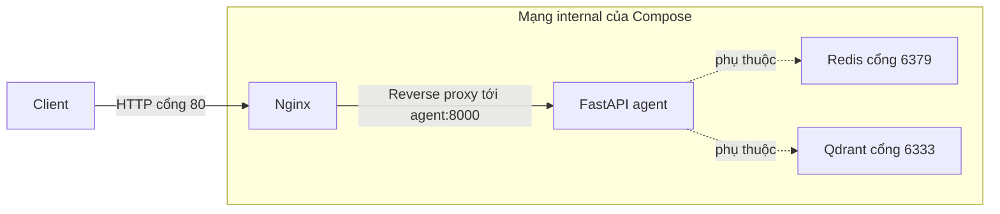

# Day 14 — Mission Answers

## Part 1 — Localhost vs Production

### Exercise 1.1 — Anti-patterns trong bản develop

1. **Thông tin xác thực được ghi cứng trong mã nguồn.** `OPENAI_API_KEY` và `DATABASE_URL` có sẵn giá trị mẫu. Nếu thay chúng bằng thông tin thật rồi push lên GitHub, thông tin đó sẽ nằm trong lịch sử Git. Bản production đọc `OPENAI_API_KEY` từ biến môi trường. [Develop, dòng 17–18](01-localhost-vs-production/develop/app.py#L17-L18) · [Production, dòng 27](01-localhost-vs-production/production/config.py#L27)
2. **Log chứa thông tin nhạy cảm.** Bản develop in API key, toàn bộ câu hỏi và câu trả lời. Nếu đưa log vào hệ thống tập trung, người có quyền đọc log có thể thấy thông tin này. Với request này, bản production ghi độ dài câu hỏi, IP client và độ dài câu trả lời. [Develop, dòng 33–38](01-localhost-vs-production/develop/app.py#L33-L38) · [Production, dòng 111–122](01-localhost-vs-production/production/app.py#L111-L122)
3. **Thiếu endpoint kiểm tra tình trạng.** Bản develop chỉ có `/` và `/ask`, nên nền tảng thiếu tín hiệu riêng để biết process còn sống và app đã sẵn sàng nhận request hay chưa. Bản production có `/health` và `/ready`. [Develop, dòng 25–43](01-localhost-vs-production/develop/app.py#L25-L43) · [Production, dòng 135–161](01-localhost-vs-production/production/app.py#L135-L161)
4. **Địa chỉ lắng nghe và cổng bị cố định.** `host="localhost"` chỉ nhận kết nối qua loopback, còn `port=8000` bỏ qua cổng do nền tảng cấp. Bản production đọc `HOST` và `PORT` từ môi trường, mặc định lắng nghe trên `0.0.0.0:8000`. [Develop, dòng 49–53](01-localhost-vs-production/develop/app.py#L49-L53) · [Production, dòng 17–18](01-localhost-vs-production/production/config.py#L17-L18)
5. **Tự nạp lại mã luôn được bật khi chạy `python app.py`.** `reload=True` hữu ích khi sửa code, nhưng thay đổi file có thể làm server khởi động lại trong lúc đang phục vụ. Bản production điều khiển chế độ này bằng `DEBUG`, mặc định là `false`. [Develop, dòng 53](01-localhost-vs-production/develop/app.py#L53) · [Production, cấu hình `DEBUG`](01-localhost-vs-production/production/config.py#L19) · [Production, cấu hình Uvicorn](01-localhost-vs-production/production/app.py#L194-L199)
6. **Thiếu xử lý dọn dẹp ở cấp ứng dụng khi tắt.** Bản develop không khai báo `lifespan` cho FastAPI. Bản production dùng `lifespan` để cập nhật trạng thái readiness khi khởi động và khi tắt, đồng thời có chỗ để dọn tài nguyên. [Develop, dòng 13](01-localhost-vs-production/develop/app.py#L13) · [Production, dòng 39–67](01-localhost-vs-production/production/app.py#L39-L67)

### Exercise 1.2 — Chạy bản develop

```powershell
curl.exe -i -X POST "http://localhost:8000/ask?question=Hello"
```

Kết quả từ terminal:

```http
HTTP/1.1 200 OK
content-type: application/json

{"answer":"Agent đang hoạt động tốt! (mock response) Hỏi thêm câu hỏi đi nhé."}
```

Endpoint `POST /ask` nhận `question` qua query string và trả câu trả lời mẫu trong trường `answer`.

### Exercise 1.3 — So sánh develop và production

Bản production khởi động trên `127.0.0.1:8000` với mock LLM. Kết quả kiểm tra trên server local:

| Lệnh kiểm tra | HTTP | Trường trong phản hồi |
| --- | --- | --- |
| `curl.exe -i http://127.0.0.1:8000/health` | `200 OK` | `"status": "ok"` |
| `curl.exe -i http://127.0.0.1:8000/ready` | `200 OK` | `"ready": true` |

| Tính năng | Develop | Production | Vì sao quan trọng |
| --- | --- | --- | --- |
| Cấu hình | Giá trị mẫu, địa chỉ lắng nghe và cổng được ghi trực tiếp trong code. | `Settings` đọc các biến như `HOST`, `PORT`, `DEBUG` và `OPENAI_API_KEY` từ môi trường. | Có thể dùng cùng mã nguồn ở nhiều môi trường và cấp secret qua cấu hình triển khai. |
| Health check | Chỉ có `/` và `/ask`. | `/health` báo app còn chạy. `/ready` trả `503` khi cờ `is_ready` là `False`. | Nền tảng có thể kiểm tra app còn sống, còn bộ cân bằng tải có thể dùng readiness để quyết định có chuyển request đến app hay không. |
| Logging | Dùng `print()` để ghi API key, câu hỏi và câu trả lời. | Dùng `logging` và tạo sự kiện có cấu trúc cho request và response. Các sự kiện này ghi thông tin như độ dài câu hỏi thay cho nội dung câu hỏi. | Dễ lọc và tra cứu theo sự kiện, đồng thời giảm nguy cơ lộ thông tin trong log. |
| Graceful shutdown | App không có hàm `lifespan` để dọn dẹp khi tắt. | Uvicorn xử lý quá trình dừng server. Trong bước shutdown, `lifespan` cập nhật `is_ready = False` và ghi log. | Khi nhận tín hiệu dừng, server có thể cho request đang xử lý hoàn tất trong thời gian cho phép rồi chạy bước dọn dẹp. |

## Part 2 — Docker

### Exercise 2.1 — Đọc Dockerfile develop

1. **Base image.** `FROM python:3.11` chọn image Python 3.11 làm nền cho image develop. [Dockerfile, dòng 8](02-docker/develop/Dockerfile#L8)
2. **Thư mục làm việc.** `WORKDIR /app` đặt `/app` làm thư mục làm việc bên trong container. Các đích tương đối như `.` trong lệnh `COPY` được tính từ thư mục này. [Dockerfile, dòng 11–14](02-docker/develop/Dockerfile#L11-L14)
3. **Thứ tự `COPY` và cache.** Dockerfile copy `requirements.txt` rồi chạy `pip install` trước khi copy `app.py`. Khi chỉ sửa `app.py`, Docker có thể dùng lại các layer cài thư viện đã được cache và build lại từ bước copy mã ứng dụng. [Dockerfile, dòng 14–20](02-docker/develop/Dockerfile#L14-L20)
4. **`CMD` và `ENTRYPOINT`.** Ở dạng exec, `ENTRYPOINT` chỉ định chương trình chính. `CMD` cung cấp lệnh mặc định khi không có `ENTRYPOINT`, hoặc cung cấp đối số mặc định cho `ENTRYPOINT`. Dockerfile này dùng `CMD ["python", "app.py"]` để mặc định chạy `python app.py`. Có thể thay `CMD` bằng lệnh hoặc đối số truyền sau tên image trong `docker run`. [Dockerfile, dòng 30](02-docker/develop/Dockerfile#L30)

### Exercise 2.2 — Build và chạy container develop

```powershell
docker build -f 02-docker/develop/Dockerfile -t my-agent:develop .
docker run --rm -p 127.0.0.1:8000:8000 my-agent:develop
```

Log của Uvicorn xác nhận app đã khởi động trong container. Kết quả gọi qua cổng `8000` trên máy host:

| Lệnh kiểm tra | HTTP | Phản hồi |
| --- | --- | --- |
| `curl.exe -i http://127.0.0.1:8000/health` | `200 OK` | JSON có `"status": "ok"` và `"container": true`. |
| `curl.exe -i -X POST "http://127.0.0.1:8000/ask?question=Hello"` | `200 OK` | `{"answer":"Đây là câu trả lời từ AI agent (mock). Trong production, đây sẽ là response từ OpenAI/Anthropic."}` |

### Exercise 2.3 — Multi-stage build và kích thước image

```powershell
docker build -f 02-docker/production/Dockerfile -t my-agent:advanced .
docker images my-agent
```

| Chỉ số từ `docker images` | `my-agent:develop` | `my-agent:advanced` | Mức giảm so với develop |
| --- | --- | --- | --- |
| `DISK USAGE` | 1.67 GB | 240 MB | ≈ 85.6% |
| `CONTENT SIZE` | 426 MB | 57.4 MB | ≈ 86.5% |

Mức giảm được tính bằng `(develop − advanced) / develop × 100%` cho từng cột. Khi tính `DISK USAGE`, đổi `1.67 GB` thành `1670 MB` để dùng cùng đơn vị. Phần trăm là giá trị gần đúng vì Docker hiển thị kích thước đã làm tròn.

Image develop dùng `python:3.11` trong một stage. Image advanced dùng `python:3.11-slim` ở cả hai stage. Stage `builder` cài công cụ build như `gcc` và `libpq-dev` để cài thư viện. Stage `runtime` bắt đầu từ một base slim mới và chép sang phần thư viện đã cài cùng mã ứng dụng. Các công cụ build chỉ nằm trong stage `builder`. [Dockerfile develop](02-docker/develop/Dockerfile#L8-L24) · [Dockerfile production](02-docker/production/Dockerfile#L16-L52)

### Exercise 2.4 — Docker Compose và kiểm thử qua Nginx

Chạy trong `02-docker/production/` sau khi tạo file `.env.local` rỗng.

```powershell
docker compose -p k5-day14-docker up -d --build
docker compose -p k5-day14-docker ps
```

Compose khởi động bốn service. Redis và Qdrant đã `healthy` khi `ps` được chạy. Nginx đã mở cổng HTTP `80`, còn agent đang ở trạng thái `health: starting` tại thời điểm đó.



Nginx nhận request từ máy host và chuyển tiếp đến `agent:8000` qua mạng `internal`. Compose đợi Redis và Qdrant đạt `healthy` trước khi khởi động agent. [Compose](02-docker/production/docker-compose.yml#L17-L100) · [Nginx](02-docker/production/nginx/nginx.conf#L14-L62)

```powershell
curl.exe -i http://127.0.0.1/health
$body = @{ question = 'Explain microservices' } | ConvertTo-Json -Compress
$body | curl.exe -i -X POST http://127.0.0.1/ask -H 'Content-Type: application/json' --data-binary '@-'
```

| Request qua cổng `80` | HTTP | Phản hồi |
| --- | --- | --- |
| `GET /health` | `200 OK` | Có `Server: nginx`. JSON có `"status": "ok"` và `"version": "2.0.0"`. |
| `POST /ask` với JSON `{"question":"Explain microservices"}` | `200 OK` | Có `Server: nginx`. JSON trả `{"answer":"Agent đang hoạt động tốt! (mock response) Hỏi thêm câu hỏi đi nhé."}`. |

## Part 4 — API Security

### Exercise 4.1 — Xác thực bằng API key

Bản develop chạy ở `http://127.0.0.1:8000`. Cả hai lần gọi `POST /ask` đều gửi JSON `{"question":"Hello"}`.

**Lần 1 gửi request thiếu `X-API-Key`.**

```http
HTTP/1.1 401 Unauthorized
content-type: application/json

{"detail":"Missing API key. Include header: X-API-Key: <your-key>"}
```

**Lần 2 gửi header `X-API-Key` đúng với biến môi trường `AGENT_API_KEY`.**

```http
HTTP/1.1 200 OK
content-type: application/json

{"question":"Hello","answer":"Tôi là AI agent được deploy lên cloud. Câu hỏi của bạn đã được nhận."}
```

`POST /ask` khai báo dependency `verify_api_key`. Dependency đọc `X-API-Key`, trả `401` khi key thiếu hoặc sai và cho phép endpoint xử lý câu hỏi khi key hợp lệ. Để đổi key trong bản mẫu, cập nhật `AGENT_API_KEY` rồi khởi động lại server và cập nhật client. [Kiểm tra API key](04-api-gateway/develop/app.py#L35-L55) · [Endpoint `/ask`](04-api-gateway/develop/app.py#L67-L80)

### Exercise 4.2 — Xác thực bằng JWT

Đăng nhập bằng tài khoản mẫu `student` qua `POST /auth/token`, lưu `access_token` vào biến `$token` trong PowerShell và gửi `Authorization: Bearer $token` khi gọi `POST /ask`. Log Uvicorn ghi lại cả hai request thành công.

```text
INFO:     127.0.0.1:60022 - "POST /auth/token HTTP/1.1" 200 OK
INFO:     127.0.0.1:60023 - "POST /ask HTTP/1.1" 200 OK
```

Server kiểm tra thông tin đăng nhập trước khi ký JWT bằng `HS256`. Token có các trường `sub` (tên người dùng), `role` (vai trò) và `exp` (thời điểm hết hạn). Khi nhận Bearer token, dependency `verify_token` xác minh chữ ký và thời hạn rồi lấy thông tin người dùng từ token. [Luồng đăng nhập và `/ask`](04-api-gateway/production/app.py#L105-L129) · [Tạo và xác minh JWT](04-api-gateway/production/auth.py#L35-L68)

### Exercise 4.3 — Kiểm tra rate limit

Vòng lặp dùng JWT của tài khoản `student` để gọi liên tiếp `POST /ask`. Log của lần chạy trên máy local ghi nhận request hợp lệ rồi đến request bị giới hạn.

```text
INFO:     127.0.0.1:60068 - "POST /ask HTTP/1.1" 200 OK
INFO:     127.0.0.1:60069 - "POST /ask HTTP/1.1" 429 Too Many Requests
```

Phản hồi từ lần kiểm tra lại bằng `curl.exe -i` với cùng tài khoản trên server local.

```http
HTTP/1.1 429 Too Many Requests
x-ratelimit-limit: 10
x-ratelimit-remaining: 0
retry-after: 12
content-type: application/json

{"detail":{"error":"Rate limit exceeded","limit":10,"window_seconds":60,"retry_after_seconds":12}}
```

Rate limiter dùng cửa sổ trượt. Nó lưu thời điểm các request theo từng tài khoản và loại mục cũ hơn 60 giây trước khi đếm. Người dùng thường có giới hạn 10 request mỗi 60 giây, còn admin có giới hạn riêng là 100 request mỗi 60 giây. `Retry-After` cho biết client nên đợi bao lâu cho đến khi có lượt mới. `req` trong log `cost_guard` là tổng request đã được ghi nhận trong ngày, nên có thể lớn hơn 10 dù cửa sổ 60 giây vẫn được áp dụng. [Rate limiter](04-api-gateway/production/rate_limiter.py#L29-L87) · [Chọn giới hạn theo vai trò](04-api-gateway/production/app.py#L137-L145) · [Ghi nhận usage](04-api-gateway/production/cost_guard.py#L93-L108)

### Exercise 4.4 — Cost guard

Rate limiter giới hạn tốc độ request. Cost guard giới hạn tiền chi cho LLM dựa trên token đầu vào và đầu ra. Một request có prompt dài hoặc sinh nhiều token có thể tốn nhiều tiền dù số request vẫn nằm trong giới hạn.

Trong bản mẫu, `/ask` gọi `check_budget` trước khi gọi mock LLM. Khi số tiền của người dùng đạt ngưỡng trong ngày, app trả `402`. Khi bộ đếm tổng đạt ngưỡng toàn hệ thống, app trả `503`. Sau khi nhận kết quả, `record_usage` cộng số token và số request. Ngưỡng trong bản mẫu là 1 USD mỗi người dùng mỗi ngày và 10 USD cho bộ đếm tổng. [Luồng `/ask`](04-api-gateway/production/app.py#L137-L157) · [Kiểm tra ngân sách và ghi nhận usage](04-api-gateway/production/cost_guard.py#L60-L108) · [Ngưỡng ngân sách](04-api-gateway/production/cost_guard.py#L128)

Với bài tập ngân sách 10 USD mỗi tháng, có thể lưu chi phí theo key Redis `budget:<user_id>:<YYYY-MM>`. Trước khi gọi model, ước tính chi phí request từ số token đầu vào và giới hạn đầu ra. Kiểm tra tổng hiện tại cộng chi phí dự kiến rồi giữ ngân sách trong cùng một thao tác nguyên tử để các request chạy đồng thời không cùng sử dụng một khoản ngân sách. Trả `402` nếu tổng dự kiến vượt 10 USD. Sau khi có số token thực tế, cập nhật phần chênh lệch. Sang tháng mới, key theo tháng thay đổi và chi phí bắt đầu lại từ 0. [Đề Exercise 4.4](CODE_LAB.md#exercise-44-cost-guard)

## Part 5 — Scaling & Reliability

### Exercise 5.1 — Liveness và readiness

Chạy bản develop ở `05-scaling-reliability/develop/` rồi kiểm tra hai endpoint.

| Lệnh kiểm tra | HTTP | Phản hồi |
| --- | --- | --- |
| `curl.exe -i http://127.0.0.1:8000/health` | `200 OK` | `"status": "ok"`, uptime `12.2` giây và bộ nhớ đang dùng `74.8%` trong lần kiểm tra. |
| `curl.exe -i http://127.0.0.1:8000/ready` | `200 OK` | Lần kiểm tra lại nhận `{"ready":true,"in_flight_requests":1}`. |

`/health` là liveness probe. Nó báo trạng thái process cùng thông tin chẩn đoán như uptime và mức sử dụng bộ nhớ. `/ready` là readiness probe để bộ cân bằng tải biết có nên chuyển request vào instance. Endpoint này trả `503` khi cờ `_is_ready` là `False`. Bộ đếm `in_flight_requests` tính cả request đang gọi `/ready` vì middleware tăng bộ đếm trước khi chạy handler. [Middleware theo dõi request](05-scaling-reliability/develop/app.py#L72-L81) · [Hai endpoint](05-scaling-reliability/develop/app.py#L104-L166)

### Exercise 5.2 — Graceful shutdown

Trên Windows, tôi gửi `POST /ask?question=Long%20task` rồi dùng `Ctrl+C` để dừng server. Log của lần chạy ghi lại phản hồi `200 OK` và quá trình dừng hoàn tất.

```text
INFO:     127.0.0.1:58132 - "POST /ask?question=Long%20task HTTP/1.1" 200 OK
INFO:     Shutting down
INFO:     Waiting for application shutdown.
2026-11-26 16:36:41,931 INFO ✅ Shutdown complete
INFO:     Application shutdown complete.
INFO:     Finished server process [24752]
```

AI kiểm tra riêng trên một tiến trình local của cùng app. Lệnh kiểm thử đợi request đi vào mock LLM rồi gửi `CTRL_BREAK_EVENT` của Windows trước khi nhận phản hồi. Request vẫn trả HTTP `200`, server ghi `Shutdown complete` và tiến trình thoát với mã `0`.

Bản mẫu đếm request đang xử lý qua middleware. Khi chạy bước shutdown của `lifespan`, ứng dụng đặt `_is_ready = False` và ghi log dừng. Uvicorn có thời gian chờ graceful shutdown được cấu hình là 30 giây. [Lifespan và middleware](05-scaling-reliability/develop/app.py#L41-L81) · [Cấu hình Uvicorn](05-scaling-reliability/develop/app.py#L190-L199)

### Exercise 5.3 — Stateless design

Mỗi replica có vùng nhớ riêng. Nếu agent lưu history trong RAM, hai request của cùng một session có thể đến hai replica và mỗi replica chỉ thấy phần history do nó lưu. Trong stack production, các replica cùng kết nối Redis. Khi nhận `session_id`, agent đọc và cập nhật cùng key `session:<session_id>` trong Redis. Nhờ vậy một replica khác vẫn có thể tiếp tục cuộc trò chuyện khi Nginx chuyển request tiếp theo sang nó. [Kết nối Redis và lưu session](05-scaling-reliability/production/app.py#L36-L89) · [Xử lý `/chat`](05-scaling-reliability/production/app.py#L128-L157)

### Exercise 5.4 — Cân bằng tải qua Nginx

```powershell
docker compose -p k5-day14-scaling up -d --build --scale agent=3
python -X utf8 test_stateless.py
```

Test gọi API qua Nginx ở `http://localhost:8080`. Trường `served_by` trong phản hồi cho thấy cả ba replica đều xử lý request.

| Request | Replica phục vụ |
| --- | --- |
| 1 | `instance-cc5737` |
| 2 | `instance-365d06` |
| 3 | `instance-2a9777` |
| 4 | `instance-cc5737` |
| 5 | `instance-365d06` |

Kiểm tra thêm `GET /health` qua Nginx nhận `"storage":"redis"` và `"redis_connected":true` từ `instance-cc5737`. [Upstream của Nginx](05-scaling-reliability/production/nginx.conf#L7-L29) · [Cấu hình Compose](05-scaling-reliability/production/docker-compose.yml)

### Exercise 5.5 — Kiểm tra lịch sử session

Script gửi 5 câu hỏi với cùng `session_id` (`82472fd0-d492-4a4f-9c47-0fde14c4e07e`). Sau đó `GET /chat/{session_id}/history` trả đủ **10 tin nhắn**, gồm 5 câu hỏi và 5 câu trả lời. Kết hợp với `served_by` của từng request, kết quả cho thấy các replica đã đọc và ghi cùng một lịch sử trong Redis. [Kịch bản kiểm tra](05-scaling-reliability/production/test_stateless.py)

## Part 6 — Production-ready agent

### Kiểm tra liveness

Sau khi thêm `GET /health` vào `app/main.py`, tôi chạy Uvicorn trong Ubuntu WSL bằng Python `3.11.18`. Lệnh `curl -i http://127.0.0.1:8000/health` trả về:

```http
HTTP/1.1 200 OK
content-type: application/json

{"status":"ok"}
```

### Kết quả Production Readiness Check

Tôi chạy `python check_production_ready.py` ở chế độ đầy đủ bằng Python `3.11.18` và Docker trong Ubuntu WSL2. Tôi dùng bản sao `06-lab-complete/` trên hệ thống tệp Linux để Compose nhận đường dẫn hợp lệ.

```text
📋 Checklist Deliverable
   ✅ Dockerfile (multi-stage, < 500 MB)
   ✅ docker-compose.yml (agent + redis)
   ✅ .dockerignore
   ✅ Health check endpoint (GET /health)
   ✅ Readiness endpoint (GET /ready)
   ✅ API Key authentication
   ✅ Rate limiting
   ✅ Cost guard
   ✅ Config từ environment variables
   ✅ Structured logging
   ✅ Graceful shutdown
   ✅ Public URL ready (Railway / Render config)
Result: 12/12 tiêu chí đạt · 42/42 checks passed
🎉 PASS 12/12 — PRODUCTION READY! Deploy nào!
```

## AI log

- Exercise 1.2: Tôi hỏi cách chạy và ghi kết quả kiểm thử. AI hướng dẫn truyền `question` qua query string và giúp ghi lại kết quả từ ảnh. Tôi tự chạy lệnh trong PowerShell và kiểm tra phản hồi `200 OK` cùng trường `answer`.
- Exercise 1.3: Tôi chạy bản production và gửi ảnh terminal xác nhận app đã khởi động. AI gọi `/health` và `/ready` trên server local rồi ghi lại mã HTTP và các trường phản hồi.
- Tôi nhờ AI giúp hoàn thiện Exercise 1.1 và 1.3. AI đọc code của hai bản, đề xuất sáu anti-pattern kèm dòng code và điền bảng so sánh. Tôi đã tự chạy cả hai bản và xác nhận `/ask` ở bản develop trả `200 OK`. Tôi sẽ bổ sung ghi chú tự đối chiếu code và các chỉnh sửa của mình sau khi rà soát.
- Ở Exercise 2.2, AI hướng dẫn dùng registry mirror sau lỗi `429`. Tôi tự cấu hình mirror, tải `python:3.11`, build image, chạy container và kiểm tra request qua log Uvicorn. AI gọi lại hai endpoint trên container local và ghi kết quả vào bài.
- Ở Exercise 2.3, tôi tự build image và chạy `docker images my-agent`. AI đọc hai cột kích thước từ ảnh terminal, tính phần trăm giảm theo từng cột và đối chiếu các stage với Dockerfile.
- Ở Exercise 2.4, tôi tạo `.env.local`, chạy Docker Compose và gửi log `ps` để kiểm tra trạng thái service. AI đọc cấu hình để vẽ sơ đồ, gọi `/health` và `/ask` qua Nginx trên máy local rồi ghi kết quả.
- Khi tôi hỏi bước tiếp theo sau khi tắt stack, AI điền bản gợi ý cho bốn câu Exercise 2.1 dựa trên Dockerfile. Tôi đã tự build và chạy image đó ở Exercise 2.2. Các dòng Dockerfile được dẫn để tôi tự đối chiếu phần giải thích.
- Ở Exercise 4.1, tôi tự chạy app và gửi hai request, rồi kiểm tra log Uvicorn có `401` và `200`. AI gọi lại hai request trên app local, ghi phản hồi và đối chiếu cách kiểm tra key với mã nguồn.
- Ở Exercise 4.2, tôi tự chạy bản production, lấy JWT và dùng nó gọi `/ask`. Tôi kiểm tra log có `200 OK` cho cả hai request. AI chép trạng thái từ ảnh vào báo cáo và đối chiếu luồng JWT với mã nguồn.
- Ở Exercise 4.3, tôi tự chạy vòng lặp và thấy `429` trong log. AI chép log từ ảnh và gọi lại trên server local để bổ sung phản hồi có `Retry-After`. AI cũng gợi ý cách giải thích cost guard trong Exercise 4.4 dựa trên mã mẫu và yêu cầu ngân sách tháng.
- Ở Exercise 5.1, tôi tự chạy app mẫu và kiểm tra `/health` cùng `/ready` trả `200 OK`. AI gọi lại `/ready` để bổ sung JSON và đối chiếu cấu trúc phản hồi với mã nguồn.
- Ở Exercise 5.2 và 5.3, AI hướng dẫn thử dừng server và giải thích cách các replica dùng chung Redis. Tôi tự gửi request, dùng `Ctrl+C` và kiểm tra log Uvicorn. AI chép log tôi gửi và chạy thêm một lượt kiểm tra bằng `CTRL_BREAK_EVENT` để xác nhận sau khi tín hiệu dừng được gửi, request đang xử lý vẫn trả `200`.
- Ở Exercise 5.4 và 5.5, tôi tự chạy script kiểm thử và quan sát ba instance cùng 10 tin nhắn. AI ghi lại thứ tự các instance, gọi `/health` để xác nhận Redis đang kết nối và đọc lại cùng session để kiểm tra số tin nhắn theo vai trò.
- Ở Part 6, AI gợi ý tạo môi trường Python 3.11, thêm route `/health` và kiểm tra bằng `curl`. Tôi tự cài môi trường trong WSL, sửa `app/main.py`, chạy Uvicorn và kiểm tra phản hồi `200 OK`. AI ghi lại kết quả và gợi ý bước đọc cấu hình từ biến môi trường.
- Tôi chạy checker đầy đủ trong Ubuntu và nhận `7/12`. AI đối chiếu lỗi Docker trong WSL, sửa phần bị lặp ở dòng `CMD` trong Dockerfile và dùng trình phân tích JSON để kiểm tra cú pháp. Tôi bật tích hợp Docker cho Ubuntu, thêm tài khoản vào nhóm `docker` và chạy lại.
- Khi checker đạt `11/12` nhưng Compose ghép sai đường dẫn, AI hướng dẫn chạy từ bản sao trên hệ thống tệp Linux. Tôi tự kiểm tra lại Compose và chạy checker đầy đủ. Kết quả cuối cùng là `PASS 12/12` với `42/42 checks passed`.
- Khi tôi hỏi cách deploy ở Part 3, AI đối chiếu tài liệu Render và cập nhật Blueprint dùng Dockerfile của Part 6, Key Value nội bộ và API key do Render sinh. Tôi sẽ xác nhận cấu hình bằng các lệnh thử trên URL công khai sau khi triển khai.
